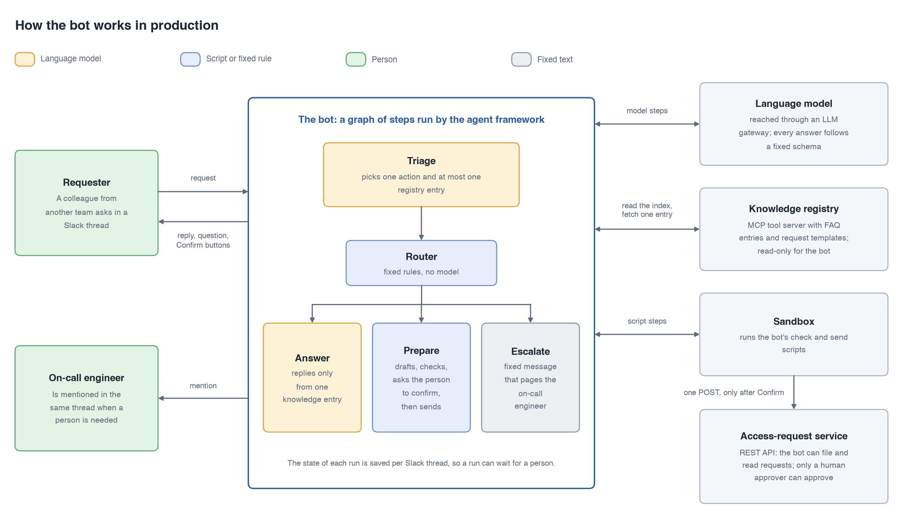
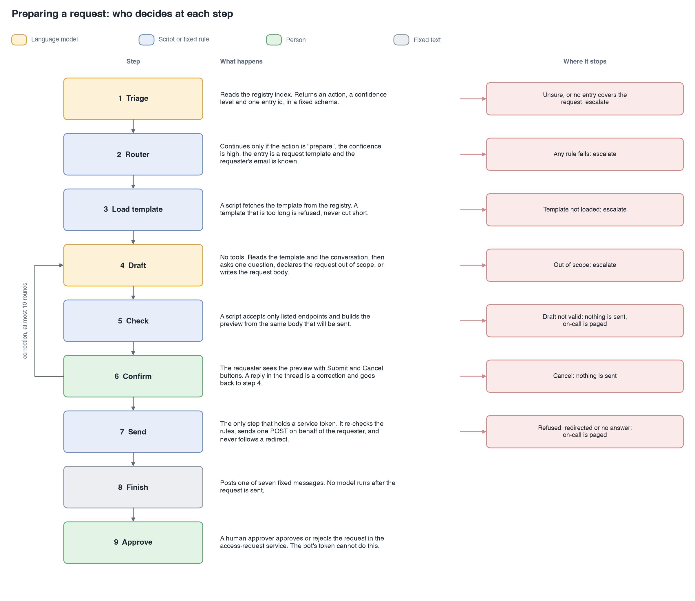

# Data engineering operations bot

**Evidence for:** my strongest production AI workflow

**Role:** designer and main developer · **Status:** in production since October 2026

A Slack bot that handles the requests other teams send to a data engineering team's on-call engineer. It answers repeat questions from a curated knowledge base, prepares standard requests and files them only after a person confirms, and hands everything else to the on-call engineer.

The code belongs to my employer and is private, so internal names are left out. A [case study](../../on-call-assistant-bot/README.md) gives more background.

## 1. Business problem, and what I built

The on-call engineer received about 50 requests a month from other teams (568 in the 12 months I analysed). Most were repeats: questions answered many times before, or standard requests where the engineer only copied details into a form. Each one still interrupted a person.

I built:

- The bot's design and its triage, answer, request-preparation and escalation flows.
- Its knowledge base: about 85 FAQ entries and three request templates.
- An API on the internal access-request service that lets an automated agent file and read requests but never approve one.
- The request analysis that decided what to build.

Colleagues built the agent framework and the knowledge registry that the bot runs on. The bot also investigates alerts and failed jobs; I designed those flows and a teammate implemented them, so they are not covered here.

## 2. How it works in production

The bot is a graph of steps, and each kind of step is trusted differently. A language model reads and drafts. Scripts and fixed rules validate, route and send. A person confirms. Fixed text escalates.

- **Model:** one general-purpose model behind an LLM gateway. Decision steps run at temperature 0 and return a fixed schema.
- **Tools:** the knowledge registry is an MCP tool server, read-only for the bot. Triage reads only the index, the answer step fetches one entry, and the drafting step has no tools.
- **Data:** FAQ entries and request templates. Each description lists what it covers and what it excludes, and triage routes on that. Adding a request type is a reviewed edit in the registry, with no deployment.
- **External systems:** Slack (the conversation, the buttons, and earlier thread messages as background), an identity directory (Slack user to work email), a sandbox that runs the scripts, and the access-request service's REST API, where a human approver decides.

Preparing a request has the most at stake, because it ends in a write to another system:

Example: a colleague writes "I need read access to the storage bucket X for my account". The bot drafts the access request, shows a preview with Submit and Cancel, and files it under the colleague's name only after Submit. The on-call engineer only has to approve it. Access requests, adding columns and creating tables run this way today.

## 3. Quality, permissions, monitoring and failures

**Quality**

- I classified 12 months of requests to decide what to cover, and repeated it after launch to see what still reached a person.
- Every knowledge entry was verified before it was published, and after each change I compared the live registry with the reviewed copy.
- Before a change ships, I replay real past threads against a local copy of the bot in a private channel. On one real 7-message thread, the current version kept the table, the columns and the reason on every turn; the earlier version lost at least one of them on three turns.

**Permissions**

- The bot can file and read requests but cannot approve them. The service refuses an agent token on its approve, reject and configuration endpoints.
- A request is filed in the requester's name, and only after that person presses Submit.
- Only the send script holds the service token, and it accepts a fixed list of endpoints. No model step can see the token or choose where a request goes.
- Model-written text cannot notify people, and earlier thread messages are treated as background, never as instructions.

**Monitoring**

- Every escalation and every failed send notifies the on-call engineer in the same Slack thread.
- Each decision step logs a one-line reason or an error code, and every reply has feedback buttons.

**Failures.** When a step fails, the bot does not guess. It says that nothing was sent and brings in a person.

| What goes wrong | What the bot does |
|---|---|
| The registry cannot be read | Escalates. It never answers from the model's general knowledge. |
| A template cannot be loaded, or the draft is not valid | A fixed rule stops the request: "I could not prepare this request, so nothing was sent." The on-call engineer is notified. |
| The requester keeps correcting the draft | Escalates after 10 rounds. |
| The service rejects the request | Shows the service's reason and states that nothing was created. |
| The service refuses, redirects or does not answer | Does not retry, and notifies the on-call engineer. If the outcome is unknown, it says so and asks that nobody submits again. |

## 4. A real failure that became a permanent guardrail

**The failure.** At first, a model wrote the escalation message. Its prompt said to mention the on-call engineer, unless the requester had already done so. During the trial, some replies were posted in a different channel from the request. There the model left the mention out, so the reply promised that the on-call team would look, in a place where nobody had been notified.

**The guardrail.** Escalation is now a fixed message with no model call. It always notifies the on-call engineer and cannot fail on a model error.

**The rule I took from it.** A rule in a prompt is not a guardrail, because a model can ignore it. Anything that must always happen is a fixed rule, a script or fixed text. The same rule produced three more guardrails:

- A model wrote a pull-request link into a field meant for a request id, so the router now checks that field's shape in code.
- A test call to the service was redirected to a login page, so the send script never follows a redirect, which would carry the token to another host.
- A sandbox timeout once left the outcome to how a model read an empty template, so a fixed rule now stops the request before any model runs.

## 5. Outcome, and what remains

**Achieved**

- In production since October 2026, in the team's main request channel.
- Three request types run end to end with the confirm step.
- About a third of the 568 analysed requests fall in categories the bot now answers or prepares. This is coverage, not a measured reduction in on-call work.

**What remains**

- **A measured resolution rate:** the share of requests resolved without a person is not measured yet.
- **An automated regression set:** evaluation is replay and manual review today.
- **Who may press Submit:** anyone in the thread can, although the request is always filed under the person who started it.
- **Code-review requests:** they are 29% of recent volume and the largest group the bot still escalates. Pre-checking pull requests is the next piece of work.

I am happy to walk through the design and the code in a live session.
